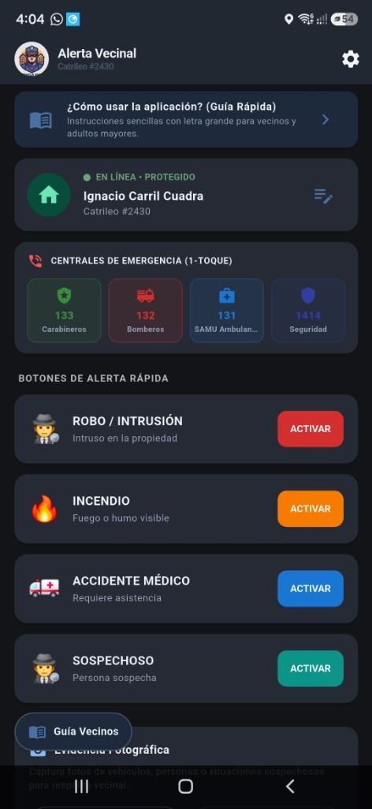
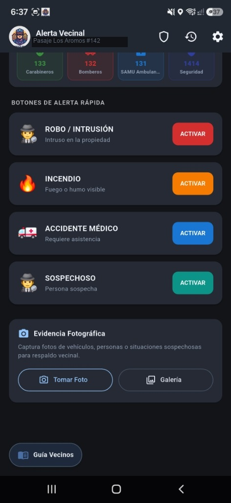
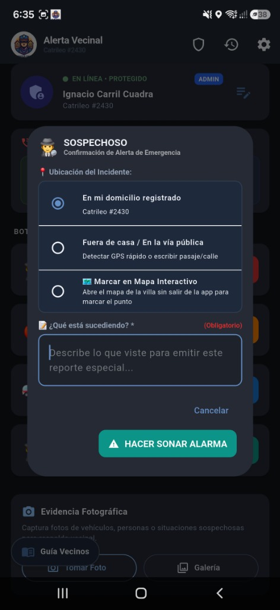
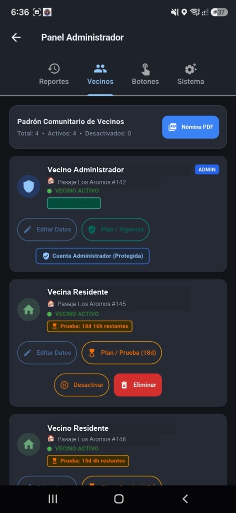
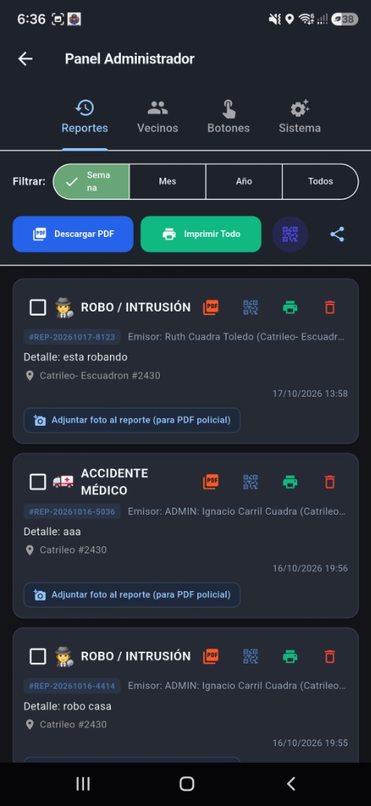
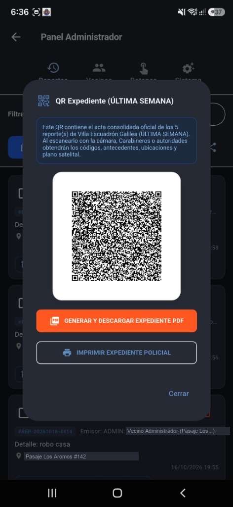
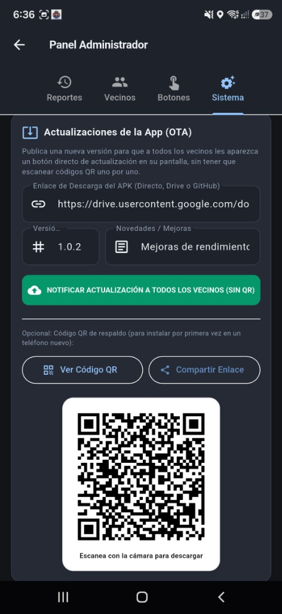

# 🛡️ Centinela Urbano — Sistema de Alerta Vecinal & Seguridad Comunitaria

<div align="center">


-red?style=for-the-badge&logo=creative-commons)

<br/>

### 📲 Descarga Directa de la Aplicación Oficial (APK)

[-059669?style=for-the-badge&logo=android&logoColor=white)](https://github.com/ignacio1123/alerta-vecinal-2/raw/master/releases/AlertaVecinal-Release.apk)

**[👉 Haz clic aquí para descargar `AlertaVecinal-Release.apk` directamente a tu celular](https://github.com/ignacio1123/alerta-vecinal-2/raw/master/releases/AlertaVecinal-Release.apk)**

*Compatible con cualquier teléfono Android 8.0 o superior. Instalación directa sin tiendas comerciales.*

> ⚠️ **AVISO DE LICENCIA NO COMERCIAL:** Este proyecto es de código abierto con fines estrictamente comunitarios y de protección vecinal. **Queda terminantemente prohibida su venta, reventa o explotación comercial por parte de terceros o empresas.**

</div>

---

## 📖 Descripción General

**Centinela Urbano** es una plataforma integral de seguridad vecinal diseñada para villas, pasajes, condominios y comités de seguridad ciudadana. Resuelve la ineficacia de los grupos de WhatsApp (donde los mensajes no despiertan a nadie de noche), garantizando que ante un evento de riesgo:
1. **Todos los teléfonos suscritos de la villa encienden su pantalla automáticamente**.
2. **Elevan el volumen al 100% y reproducen una sirena penetrante** en bucle continuo con vibración háptica, **incluso si el teléfono está bloqueado o en modo silencio**.
3. **Muestran la ubicación exacta de la emergencia en un mapa satelital** junto con la foto de evidencia y los datos del alertante.

El sistema fue diseñado e implementado a medida para la comunidad **Villa Escuadrón Galilea (Coronel, Región del Biobío, Chile)** por el desarrollador **Ignacio Carril Cuadra**.

---

## 📸 Recorrido Visual del Sistema y Módulos

A continuación se detalla el funcionamiento completo del sistema utilizando las capturas oficiales de la aplicación:

---

### 1. Vista Principal del Vecino y Centrales de Emergencia (1-Toque)

<div align="center">
  
</div>

* **Identificación Comunitaria:** En la barra superior el vecino visualiza el logo oficial junto a su dirección física registrada (ej. `Catrileo #2430`).
* **Botón de Ajustes (⚙️):** Permite cambiar con un toque entre **Modo Claro (Día)** y **Modo Oscuro (Noche)** para proteger la vista de los adultos mayores.
* **Ficha de Estado del Residente:** Indica `● EN LÍNEA • PROTEGIDO`. Cuenta con un lápiz de edición (`✏️`) protegido con un límite estricto de 3 intentos para evitar suplantaciones de identidad.
* **Centrales de Emergencia de 1-Toque (Llamada Inmediata):** Botones de marcado rápido que conectan de inmediato sin buscar en la agenda:
  * **🟢 133:** Carabineros de Chile
  * **🔴 132:** Bomberos de Chile
  * **🔵 131:** SAMU Ambulancia
  * **🛡️ 1414:** Seguridad Ciudadana Comunal (Coronel)

---

### 2. Botonera de Alerta Inmediata y Módulo de Fotos de Evidencia

<div align="center">
  
</div>

* **Los 4 Botones de Alarma Rápida:**
  * 🔴 **ROBO / INTRUSIÓN [ACTIVAR]:** Alarma de máxima prioridad. Suena en toda la villa avisando que hay delincuentes en el predio. **No exige escribir nada: suena en 1 toque.**
  * 🟠 **INCENDIO [ACTIVAR]:** Avisa fuego, humo denso o escape de gas para que los vecinos acudan con extintores y mangueras.
  * 🔵 **ACCIDENTE MÉDICO [ACTIVAR]:** Solicita auxilio urgente por caídas de adultos mayores, infartos o crisis médicas.
  * 🟢 **SOSPECHOSO [ACTIVAR]:** Alerta preventiva para que los vecinos enciendan luces exteriores y vigilen desde sus ventanas.
* **Módulo de Evidencia Fotográfica:** Permite tomar fotos en vivo con la cámara o seleccionar de la galería patentes de autos, rostros o herramientas sospechosas que quedan adjuntas al expediente.

---

### 3. Sirena Infranqueable y Confirmación en Pantalla

<div align="center">
  
</div>

* **Pantalla de Emergencia Flotante:** Al activarse una alarma, la aplicación despierta el celular mediante `Wakelock` y `Flutter Foreground Task`, sobreponiéndose a cualquier otra aplicación abierta.
* **Información Crítica Visible:** Muestra quién activó la alarma, la calle, la hora exacta, el tipo de evento y el mapa satelital con el radio de afectación.
* **Control de Silenciado:** Incluye botón para silenciar la sirena localmente una vez enterado del peligro, o llamar directamente a la patrulla comunitaria.

---

### 4. Padrón Comunitario y Gestión de Cupos por Vivienda

<div align="center">
  
</div>

* **Control de 3 Teléfonos por Hogar:** Cada vivienda de la villa tiene un plan base de hasta 3 teléfonos autorizados incluidos.
* **Cupos Extra ($5.000 CLP):** Si una familia necesita vincular un cuarto, quinto o más dispositivos, puede solicitar cupos adicionales por un costo único de **$5.000 pesos chilenos** por teléfono.
* **Botón Ampliado "Cupos Casa ($5.000)":** El Administrador cuenta con un botón táctil destacado en cada tarjeta de vecino para habilitar el nuevo cupo inmediatamente tras comprobar el pago.
* **Nómina Oficial en PDF:** Botón superior para exportar el listado completo de residentes y firmas para reuniones de junta vecinal.

---

### 5. Expedientes Policiales con Selección Múltiple (Checkbox)

<div align="center">
  
</div>

* **Selección Múltiple con Checkbox:** El Administrador puede marcar una o varias alertas ocurridas en la semana o mes.
* **Barra de Acciones Flotante (Zero-Overflow):** Al seleccionar reportes, se despliega una barra inteligente que permite:
  * **Imprimir Selección:** Genera un dossier formal en PDF con membrete oficial, coordenadas, tiempos de respuesta y fotos periciales.
  * **QR Selección:** Genera un código QR dinámico consolidado.

---

### 6. Dossier Policial en PDF y Código QR para Carabineros / PDI

<div align="center">
  
</div>

* **Entrega Inmediata a Patrullas:** Cuando llega la patrulla de Carabineros o Seguridad Ciudadana, los oficiales no necesitan ingresar a la casa ni conectar cables: simplemente escanean el código QR desde la pantalla del Administrador.
* **Descarga Automática del Expediente:** El celular policial descarga directamente el PDF legal con todos los antecedentes del delito para anexarlo al parte policial o denuncia en Fiscalía.

---

### 7. Sistema de Actualizaciones Automáticas en la Nube (OTA)

<div align="center">
  
</div>

* **Actualización sin Código QR:** El Administrador puede subir una nueva versión del APK a GitHub o Firebase Storage y publicarla con 1 toque.
* **Auto-Incremento de Versión:** Genera automáticamente el número correlativo (ej: `1.0.4`) y las notas de mejoras del sistema.
* **Notificación Inteligente en la App de los Vecinos:** A los vecinos les aparece la tarjeta de actualización. Una vez que actualizan a la última versión, el aviso **se oculta automáticamente** hasta que exista una versión nueva.

---

## 🏛️ Arquitectura Técnica

```text
alerta-vecinal/
├── app/                                  # Aplicación móvil Flutter (Dart)
│   ├── android/                          # Proyecto nativo Android y permisos críticos
│   ├── assets/
│   │   ├── images/manual/                # Capturas HD del sistema utilizadas en la documentación
│   │   └── sounds/                       # Sirenas acústicas en formato WAV (máxima fidelidad)
│   ├── lib/
│   │   ├── models/                       # Modelos (AlertModel, EmergencyButton, Locations)
│   │   ├── screens/
│   │   │   ├── home_screen.dart          # Pantalla principal del vecino con botón OTA
│   │   │   ├── admin_screen.dart         # Panel de control: Padrón, Cupos, Reportes y QR
│   │   │   └── register_screen.dart      # Validación de registro y límite de 3 teléfonos por casa
│   │   └── services/
│   │       ├── alarm_sync_service.dart   # Sincronización en tiempo real con Firebase Realtime DB
│   │       ├── alarm_player_service.dart # Reproductor de sirenas con anulación de modo silencio
│   │       ├── manual_pdf_service.dart   # Generador de manuales y expedientes policiales en PDF
│   │       └── biometric_service.dart    # Autenticación biométrica y PIN administrativo
├── releases/
│   └── AlertaVecinal-Release.apk         # APK compilado de distribución comunitaria (v1.0.4)
├── LICENSE                               # Licencia estricta de Uso No Comercial (CC BY-NC 4.0)
└── README.md                             # Documentación ilustrada oficial
```

---

## 🚫 Términos de Licencia No Comercial (CC BY-NC 4.0)

Este software ha sido creado por **Ignacio Carril Cuadra** bajo la licencia **Creative Commons Atribución-NoComercial 4.0 Internacional (CC BY-NC 4.0)**:

* **✅ Permitido:**
  * Uso libre y gratuito por cualquier junta de vecinos, pasaje, comité de seguridad o agrupación social sin fines de lucro.
  * Modificación, traducción o adaptación del código para el beneficio de comunidades barriales.
* **❌ Estrictamente Prohibido:**
  * La venta de este software, de su código fuente o de sus archivos `.apk`.
  * El cobro de mensualidades comerciales, suscripciones lucrativas o intermediación por empresas de seguridad privadas.
  * La distribución comercial bajo marcas de terceros sin autorización expresa por escrito del autor.

---

## 👨‍💻 Autor y Contacto Comunitario

* **Desarrollador y Creador:** Ignacio Carril Cuadra
* **Proyecto:** Centinela Urbano — Sistema de Alerta Vecinal
* **Comunidad Piloto:** Villa Escuadrón Galilea (Coronel, Región del Biobío, Chile)
* **Repositorio:** [github.com/ignacio1123/alerta-vecinal-2](https://github.com/ignacio1123/alerta-vecinal-2)
